<div align="center">
  <picture>
    <source media="(prefers-color-scheme: dark)" srcset="assets/banner-dark.svg">
    <source media="(prefers-color-scheme: light)" srcset="assets/banner-light.svg">
    
  </picture>
</div>

## `00` · whoami

```yaml
name:      Mehank
handle:    "@M3hank"
role:      offensive security researcher
focus:     [web app pentesting, bug bounty, recon automation]
stack:     [Go, Python, Bash, Burp Suite, Nuclei]
status:    hunting
```

I hunt the bugs scanners miss — broken authentication, access control gaps, business-logic edges, and the occasional parser quirk. When a manual step slows a hunt down, I automate it, open-source it, and put it back to work.

<sub>Currently: expanding my private `automation` suite and shipping sharper recon tooling.</sub>

---

## `01` · Selected work

Tools I built because a hunt needed them.

| Project | What it does | Stack |
| :--- | :--- | :--- |
| **[SubSentry](https://github.com/M3hank/SubSentry)** | Watches your targets for new subdomains — SQLite baselines, delta detection, and Discord · Slack · Telegram alerts. | `Python` |
| **[FavHunt](https://github.com/M3hank/FavHunt)** | Favicon fingerprinting at scale: 1,400+ hashes, infrastructure clustering, and Shodan · Censys · Fofa pivots. | `Python` |
| **[Subdomain-Analyzer](https://github.com/M3hank/Subdomain-Analyzer)** | Ranks subdomains 0–100 using headers, tech, history, and age — with `--explain` to show the math. | `Python` |
| **[umap](https://github.com/M3hank/umap)** | Streams URL lists, drops the noise, keeps the parameterized endpoints worth testing. | `Go` |
| **[ExplorerPy](https://github.com/M3hank/ExplorerPy)** | Subdomain enumeration, directory brute-forcing, and port scanning in one CLI. | `Python` |
| **[DorkSearcher](https://github.com/M3hank/DorkSearcher)** | Multi-threaded dork scanning across source trees and JS files for secrets, configs, and leftovers. | `Python` |

<sub>Also in the toolbox: [google-dorker](https://github.com/M3hank/google-dorker) for browser-based dorking · [CodeCipher](https://github.com/M3hank/CodeCipher) for payload encode/decode.</sub>

---

## `02` · Arsenal

<p>
  
  
  
  
</p>

- **Recon** — `subfinder` `httpx` `katana` `gau` `amass` `ffuf`
- **Offense** — `Burp Suite` `Nuclei` `sqlmap` `dalfox` `XSStrike`
- **Code & secrets** — `trufflehog` `gitleaks` `DorkSearcher`
- **Runtime** — `Kali Linux` `Docker` `Git` `mitmproxy`

---

## `03` · Signal

<p align="center">
  
</p>
<p align="center">
  
</p>

<sub>Public activity only — the findings themselves stay in the report.</sub>

---

## `04` · Operating principles

1. **Verify at the sink.** A sanitizer is a claim; the query is the truth.
2. **Chain the small stuff.** An info leak is ammunition, not a finding.
3. **Reproduce or it didn't happen.** A report without clean steps is a rumor.
4. **Rotate when it gets hard.** Depth is a tunnel, not a home.

---

## `05` · Connect

Open to collaboration on recon tooling, web security research, and anything that makes the next hunt faster. Email is the fastest way to reach me.

<p>
  <a href="https://github.com/M3hank"></a>
  <a href="https://tryhackme.com/p/M3hank"></a>
  <a href="https://m3hank.github.io"></a>
  <a href="mailto:m3hank1337@gmail.com"></a>
</p>

---

<p align="center">
  <sub>Learning is a lifelong process.</sub>
</p>

<p align="center">
  <code>m3hank@recon:~$ ▮</code>
</p>
